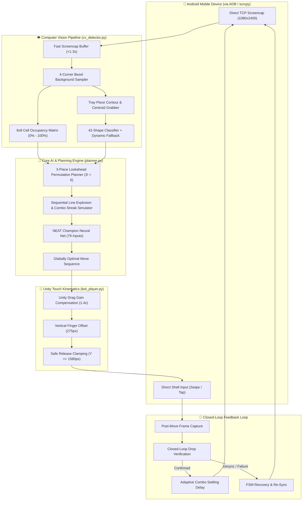

# 🎮 BlockBlast-AI: Autonomous Mobile Gameplay & NEAT Neuroevolution Engine

<div align="center">

[🇺🇸 English](README.md) | [🇧🇷 Português](README.pt-BR.md)

<br/>

[](https://github.com/marcosbinder/blockblast-ai/actions/workflows/ci.yml)
[](https://github.com/marcosbinder/blockblast-ai/releases)
[](https://www.python.org/)
[](https://neat-python.readthedocs.io/)
[](https://opencv.org/)
[](https://developer.android.com/tools/adb)
[](tests/)
[](checkpoints/)
[](LICENSE)

<p align="center">
  <b>A state-of-the-art enterprise autonomous system uniting Neuroevolution (NEAT), real-time OpenCV SIMD computer vision, closed-loop ADB mobile automation, and Unity touch physics compensation to master Block Blast.</b>
</p>

</div>

---

## 🏆 Benchmark & Milestone Records

| Metric | Champion Network Milestone |
|:---|:---:|
| **High Score Record** | **15,433+ points** |
| **Max Fitness Score** | **74,887** |
| **Generations Trained** | **817+ generations** |
| **Test Suite Coverage** | **287 / 287 automated tests (100% passing)** |
| **Decision Latency** | **< 25 ms average per 3-piece batch plan** |
| **Touch Precision** | **100% snap accuracy across all 42 canonical shapes** |

---

## 🌟 Engineering Highlights

1. **Canonical 3-Piece Permutational Beam Search (`planner.py`)**:
   - Single Source of Truth architecture shared seamlessly across training, live mobile gameplay, and replay.
   - Evaluates all tray permutations ($3! = 6$ sequence orders) with in-memory line and column explosion simulations.
   - Accurately tracks intermediate matrix state changes and propagates *Combo Streaks* across sub-steps, allowing subsequent pieces to occupy spaces created by earlier clears.

2. **NeuroEvolution of Augmenting Topologies (NEAT)**:
   - Parallel multi-core genetic training topology (79 normalized inputs $\to$ 1 output score).
   - Tactical heuristic evaluations: anti-hole isolation penalty, 3x3 center core preservation, perimeter placement bias, and row/column line-transition minimization.

3. **Theme-Agnostic OpenCV SIMD Vision Pipeline (`cv_detector.py`)**:
   - Invariant 4-corner bezel background reference (`c_tl`, `c_tr`, `c_bl`, `c_br`) supporting 0% empty, crowded, and 100% full boards without color inversion artifacts.
   - Dynamic thresholding classifying 8x8 cell occupancy and cataloging all 42 canonical Block Blast pieces with sub-60ms inference.
   - Filter guards against combo pop-up banners ("Combo!", "Great!") and explosion particle noise.

4. **Unity Touch Physics Compensation Model (`bot_player.py` & `empirical_calibrator.py`)**:
   - Inverse kinematics compensating for Unity's dynamic drag gain (`DRAG_GAIN = 1.4x`).
   - Dynamic finger lift offset ($275\text{ px}$ vertical shift) and bounding-box geometric centroid adjustment per piece shape.
   - *Safe Release Clamping* ($Y \le 1580\text{ px}$), strictly preventing drop releases in the bottom tray cancellation hazard zone ($Y \ge 1600\text{ px}$).

5. **Closed-Loop Live Play Finite State Machine (FSM)**:
   - Resilient state machine (`CAPTURE_FRAME` $\to$ `DETECT_STATE` $\to$ `PLAN_BATCH` $\to$ `EXECUTE_MOVE` $\to$ `VERIFY_DROP` $\to$ `SETTLE_ANIMATION`).
   - Post-drop visual verification with retry logic and automatic recovery upon disconnection or game-over.

---

## 🏛️ System Architecture



---

## 🎬 Visual Demonstration

| Live Autonomous Bot on Mobile Device | Interactive Pygame NEAT Dashboard |
|:---:|:---:|
|  |  |
| *Real-time closed-loop play on Motorola Moto G54 5G* | *Multi-core parallel evolution & telemetry dashboard* |

> *Place your gameplay and dashboard screen recordings into the `assets/` directory.*

---

## 📁 Repository Structure

```text
blockblast-ai/
├── .github/
│   ├── ISSUE_TEMPLATE/
│   │   ├── bug_report.md
│   │   └── feature_request.md
│   └── workflows/
│       ├── ci.yml                     # Multi-OS (Ubuntu/Windows) headless CI
│       └── release.yml                # Automated GitHub Releases on version tags
├── checkpoints/
│   ├── best_champion.pkl              # Pretrained champion neural network (15,433+ pts)
│   └── training_history.csv           # Historical generation fitness and score logs
├── tests/
│   ├── conftest.py                    # Pytest fixtures and SyntheticFrameBuilder
│   ├── test_adb_client.py             # ADB socket streaming & clamp tests (25 tests)
│   ├── test_bot_player.py             # Bot FSM & move planner tests (30 tests)
│   ├── test_cv_detector.py            # OpenCV multi-theme vision tests (20 tests)
│   ├── test_empirical_calibrator.py   # Touch calibration profile tests (30 tests)
│   ├── test_tier1_features.py         # Tier 1: Functional feature coverage (60 tests)
│   ├── test_tier2_boundaries.py       # Tier 2: Boundary value analysis (60 tests)
│   ├── test_tier3_pairwise.py         # Tier 3: Pairwise interaction tests (18 tests)
│   ├── test_tier4_workloads.py        # Tier 4: Real-world live play workloads (12 tests)
│   └── test_tier5_adversarial.py      # Tier 5: Adversarial stress & deadlocks (32 tests)
├── adb_client.py                      # Low-latency direct TCP ADB socket client
├── bot_player.py                      # Live autonomous FSM player for Android
├── calibration_profiles.json          # Calibrated geometric piece anchors and lifts
├── config-feedforward                 # NEAT neuroevolution hyperparameters
├── cv_detector.py                     # SIMD OpenCV theme-agnostic vision pipeline
├── empirical_calibrator.py            # Live touch calibration & ghost shadow analyzer
├── game.py                            # Official Block Blast simulator with 42 pieces
├── planner.py                         # Single Source of Truth 3-piece lookahead planner
├── pyproject.toml                     # Modern PEP 621 packaging metadata
├── replay.py                          # Offline match replay & telemetry engine
├── requirements.txt                   # Production & dev dependencies
├── train.py                           # Parallel NEAT genetic evolution trainer
├── visualizer.py                      # Pygame telemetry and evolution dashboard
├── CHANGELOG.md                       # Release notes and version history
├── CONTRIBUTING.md                    # Guidelines for contributors
└── LICENSE                            # MIT License (c) 2026 Marcos Binder
```

---

## 🚀 Getting Started

### Prerequisites
- **Python**: `>= 3.10` (tested on `3.10`, `3.11`, `3.12`, `3.14`)
- **Android Device**: USB Debugging enabled via Developer Options
- **ADB**: Android Debug Bridge installed and available in PATH (or `scrcpy`)

### Installation

1. **Clone the repository:**
   ```bash
   git clone https://github.com/marcosbinder/blockblast-ai.git
   cd blockblast-ai
   ```

2. **Set up a virtual environment:**
   ```bash
   python -m venv venv
   # Linux / macOS:
   source venv/bin/activate
   # Windows (PowerShell):
   .\venv\Scripts\Activate.ps1
   ```

3. **Install dependencies:**
   ```bash
   pip install -e ".[dev]"
   # or
   pip install -r requirements.txt
   ```

---

## 🕹️ Usage Guide

### 1. Run the Autonomous Bot on Your Mobile Device
Connect your Android phone via USB and ensure `adb devices` lists your device:

```bash
# Verify the plan on current screen without executing moves:
python bot_player.py --test-plan

# Execute a single test move:
python bot_player.py --test-one-move

# Launch the full closed-loop autonomous live play loop:
python bot_player.py
```

### 2. Empirical Touch Calibration (`empirical_calibrator.py`)
If running on a device with a different screen resolution or aspect ratio:

```bash
# Run the autonomous empirical touch calibrator to generate new profiles:
python empirical_calibrator.py
```

### 3. Neuroevolution Training (`train.py`)
Train new neural network champions using parallel multi-core CPU workers:

```bash
python train.py
```

**Interactive Dashboard Keyboard Shortcuts:**
- `[SPACE]`: Pause / Resume training evaluation.
- `[T]`: Toggle Turbo Mode (bypasses dashboard rendering limits).
- `[F]` or `[F11]`: Toggle Fullscreen view.
- `[ESC]`: Save checkpoint and cleanly exit.

### 4. Champion Match Replay (`replay.py`)
Watch the champion neural network play with real-time tactical evaluation metrics:

```bash
python replay.py
```

---

## 🧪 Testing & Validation

The codebase features an exhaustive **5-Tier automated test suite** with 287 tests:

```bash
# Run the complete test suite:
pytest -v

# Run specific testing tiers:
pytest -v tests/test_tier1_features.py       # Tier 1: Unit Features (60 tests)
pytest -v tests/test_tier2_boundaries.py     # Tier 2: Boundary Values (60 tests)
pytest -v tests/test_tier3_pairwise.py       # Tier 3: Pairwise Interactions (18 tests)
pytest -v tests/test_tier4_workloads.py      # Tier 4: Live Workloads (12 tests)
pytest -v tests/test_tier5_adversarial.py    # Tier 5: Adversarial Stress (32 tests)
```

Run code quality and formatting checks:
```bash
ruff check .
```

---

## 📄 License

This project is open-source software licensed under the [MIT License](LICENSE).  
Copyright (c) 2026 Marcos Binder.