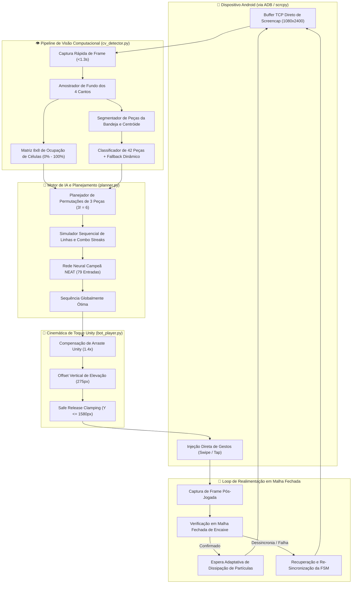
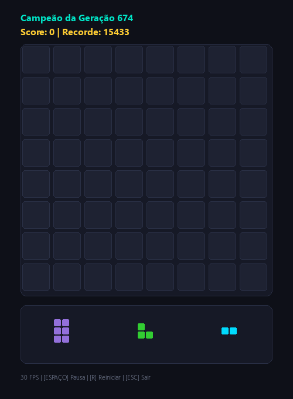

# 🎮 BlockBlast-AI: Bot Autônomo Mobile & Motor de Neuroevolução NEAT

<div align="center">

[🇺🇸 English](README.md) | [🇧🇷 Português](README.pt-BR.md)

<br/>

[](https://github.com/marcosbinder/blockblast-ai/actions/workflows/ci.yml)
[](https://github.com/marcosbinder/blockblast-ai/releases)
[](https://www.python.org/)
[](https://neat-python.readthedocs.io/)
[](https://opencv.org/)
[](https://developer.android.com/tools/adb)
[](tests/)
[](checkpoints/)
[](LICENSE)

<p align="center">
  <b>Um sistema autônomo completo de nível empresarial unindo Neuroevolução (NEAT), visão computacional OpenCV SIMD em tempo real, automação mobile em malha fechada via ADB e compensação física de toque na engine Unity para dominar o Block Blast.</b>
</p>

</div>

---

## 🏆 Marcos e Recordes do Campeão

| Métrica | Marco da Rede Campeã |
|:---|:---:|
| **Recorde de Pontuação** | **15.433+ pontos** |
| **Pontuação Máxima de Fitness** | **74.887** |
| **Gerações Evoluídas** | **817+ gerações** |
| **Cobertura de Testes** | **287 / 287 testes automatizados (100% de sucesso)** |
| **Latência de Decisão** | **< 25 ms de média por planejamento de 3 peças** |
| **Precisão de Toque** | **100% de precisão de encaixe nas 42 peças do catálogo** |

---

## 🌟 Destaques de Engenharia

1. **Planejador Canônico por Permutações e Busca em Feixe (`planner.py`)**:
   - Arquitetura de *Fonte Única da Verdade* (*Single Source of Truth*) compartilhada entre treino, jogo ao vivo e replay.
   - Avalia todas as permutações da bandeja ($3! = 6$ ordens sequenciais) com simulação exata de explosão de linhas e colunas em memória.
   - Rastreia o estado intermediário do tabuleiro e propaga *Combo Streaks* entre jogadas, permitindo que a segunda peça ocupe espaços abertos pela primeira.

2. **Neuroevolução de Topologias Aumentadas (NEAT)**:
   - Treinamento genético paralelo multi-core (topologia com 79 entradas normalizadas $\to$ 1 saída de avaliação).
   - Heurísticas táticas integradas: penalidade anti-buraco isolado, preservação do núcleo central 3x3, viabilidade de barras 5x1 e minimização de transições de linha/coluna.

3. **Pipeline de Visão Computacional OpenCV Multi-Tema (`cv_detector.py`)**:
   - Amostragem invariante de fundo nos 4 cantos da moldura (`c_tl`, `c_tr`, `c_bl`, `c_br`), operando sem falhas em tabuleiros com 0% a 100% de ocupação nos temas Madeira, Azul/Noturno, Neon e Selva.
   - Classificação das 42 formas oficiais do Block Blast com tempo de inferência sub-60ms.
   - Filtros de guarda contra banners de animação ("Combo!", "Great!") e partículas de explosão.

4. **Modelo de Compensação da Física de Toque do Unity (`bot_player.py` e `empirical_calibrator.py`)**:
   - Cinemática inversa que compensa o ganho dinâmico de arraste do Unity (`DRAG_GAIN = 1.4x`).
   - Offset vertical dinâmico do dedo ($275\text{ px}$) e ajuste de centro de massa por formato geométrico de peça.
   - *Safe Release Clamping* ($Y \le 1580\text{ px}$), impedindo solturas na zona de cancelamento da bandeja ($Y \ge 1600\text{ px}$).

5. **Máquina de Estados Finitos (FSM) em Malha Fechada**:
   - Ciclo autônomo robusto (`CAPTURE_FRAME` $\to$ `DETECT_STATE` $\to$ `PLAN_BATCH` $\to$ `EXECUTE_MOVE` $\to$ `VERIFY_DROP` $\to$ `SETTLE_ANIMATION`).
   - Confirmação visual pós-jogada com lógica de re-tentativa e recuperação automática em caso de desconexão ou game-over.

---

## 🏛️ Arquitetura do Sistema



---

## 🎬 Demonstração Visual

<p align="center">
  
</p>

---

## 📁 Estrutura de Diretórios

```text
blockblast-ai/
├── .github/
│   ├── ISSUE_TEMPLATE/
│   │   ├── bug_report.md
│   │   └── feature_request.md
│   └── workflows/
│       ├── ci.yml                     # Integração Contínua multi-OS headless (Ubuntu/Windows)
│       └── release.yml                # Publicação automatizada de releases em tags v*.*.*
├── checkpoints/
│   ├── best_champion.pkl              # Rede neural campeã treinada (15.433+ pts)
│   └── training_history.csv           # Histórico de fitness e pontuações por geração
├── tests/
│   ├── conftest.py                    # Fixtures pytest e construtor de frames sintéticos
│   ├── test_adb_client.py             # Testes do cliente ADB e limites físicos (25 testes)
│   ├── test_bot_player.py             # Testes da FSM do bot e planejador (30 testes)
│   ├── test_cv_detector.py            # Testes de visão multi-tema OpenCV (20 testes)
│   ├── test_empirical_calibrator.py   # Testes de calibração empírica de toque (30 testes)
│   ├── test_tier1_features.py         # Nível 1: Testes unitários das funcionalidades (60 testes)
│   ├── test_tier2_boundaries.py       # Nível 2: Análise de valores limite (60 testes)
│   ├── test_tier3_pairwise.py         # Nível 3: Interações modulares combinatórias (18 testes)
│   ├── test_tier4_workloads.py        # Nível 4: Cenários de jogo real e maratonas (12 testes)
│   └── test_tier5_adversarial.py      # Nível 5: Testes adversariais e anti-deadlock (32 testes)
├── adb_client.py                      # Cliente de socket TCP direto ADB de baixa latência
├── bot_player.py                      # Bot autônomo FSM para jogo ao vivo no celular
├── calibration_profiles.json          # Perfis de âncora geométrica e compensação por peça
├── config-feedforward                 # Hiperparâmetros neuroevolutivos do NEAT
├── cv_detector.py                     # Pipeline de visão computacional multi-tema SIMD
├── empirical_calibrator.py            # Calibrador empírico de toque e sombras fantasma
├── game.py                            # Simulador oficial de Block Blast com 42 peças
├── planner.py                         # Motor canônico de lookahead e extração de features
├── pyproject.toml                     # Metadados de empacotamento moderno (PEP 621)
├── replay.py                          # Motor de replay de partidas com métricas táticas
├── requirements.txt                   # Dependências de produção e desenvolvimento
├── train.py                           # Treinador paralelo genético NEAT com dashboard
├── visualizer.py                      # Interface gráfica de telemetria em Pygame
├── CHANGELOG.md                       # Histórico completo de alterações e versões
├── CONTRIBUTING.md                    # Guia de contribuição e padrões de código
└── LICENSE                            # Licença MIT (c) 2026 Marcos Binder
```

---

## 🚀 Como Começar

### Pré-requisitos
- **Python**: `>= 3.10` (validado em `3.10`, `3.11`, `3.12` e `3.14`)
- **Dispositivo Android**: Depuração USB habilitada nas Opções do Desenvolvedor
- **ADB**: Android Debug Bridge configurado no PATH do sistema (ou via `scrcpy`)

### Instalação

1. **Clonar o repositório:**
   ```bash
   git clone https://github.com/marcosbinder/blockblast-ai.git
   cd blockblast-ai
   ```

2. **Criar e ativar o ambiente virtual:**
   ```bash
   python -m venv venv
   # Linux / macOS:
   source venv/bin/activate
   # Windows (PowerShell):
   .\venv\Scripts\Activate.ps1
   ```

3. **Instalar as dependências:**
   ```bash
   pip install -e ".[dev]"
   # ou:
   pip install -r requirements.txt
   ```

---

## 🕹️ Guia de Uso

### 1. Executar o Bot Autônomo no Celular
Conecte o smartphone Android via USB e confirme que `adb devices` detecta o aparelho:

```bash
# Validar apenas o planejamento de jogadas da tela atual (sem tocar no jogo):
python bot_player.py --test-plan

# Executar 1 jogada de teste para validação física:
python bot_player.py --test-one-move

# Iniciar o loop autônomo completo em malha fechada (FSM):
python bot_player.py
```

### 2. Calibração Empírica de Toque (`empirical_calibrator.py`)
Caso execute em um aparelho com resolução ou proporção de tela diferente:

```bash
# Executa a calibração empírica autônoma para gerar novos perfis geométricos:
python empirical_calibrator.py
```

### 3. Treinamento Neuroevolutivo (`train.py`)
Treine novas redes neurais campeãs utilizando múltiplos núcleos da CPU:

```bash
python train.py
```

**Atalhos de Teclado no Dashboard Interativo:**
- `[ESPAÇO]`: Pausar / Retomar a avaliação do treinamento.
- `[T]`: Alternar o Modo Turbo (desativa o limite de renderização gráfica).
- `[F]` ou `[F11]`: Alternar visualização em Tela Cheia.
- `[ESC]`: Salvar checkpoint e sair de forma segura.

### 4. Replay da Partida do Campeão (`replay.py`)
Assista à execução da rede campeã com telemetria tática em tempo real:

```bash
python replay.py
```

---

## 🧪 Testes e Validação

O projeto conta com uma suíte exaustiva de **5 Níveis de testes automatizados** totalizando 287 casos:

```bash
# Executar a suíte completa de testes:
pytest -v

# Executar níveis específicos individualmente:
pytest -v tests/test_tier1_features.py       # Nível 1: Funcionalidades Unitárias (60 testes)
pytest -v tests/test_tier2_boundaries.py     # Nível 2: Análise de Limites (60 testes)
pytest -v tests/test_tier3_pairwise.py       # Nível 3: Interações Combinatórias (18 testes)
pytest -v tests/test_tier4_workloads.py      # Nível 4: Maratonas de Jogo Real (12 testes)
pytest -v tests/test_tier5_adversarial.py    # Nível 5: Estresse Adversarial (32 testes)
```

Validação de padrões de código e formatação:
```bash
ruff check .
```

---

## 📄 Licença

Distribuído sob a [Licença MIT](LICENSE).  
Copyright (c) 2026 Marcos Binder.
